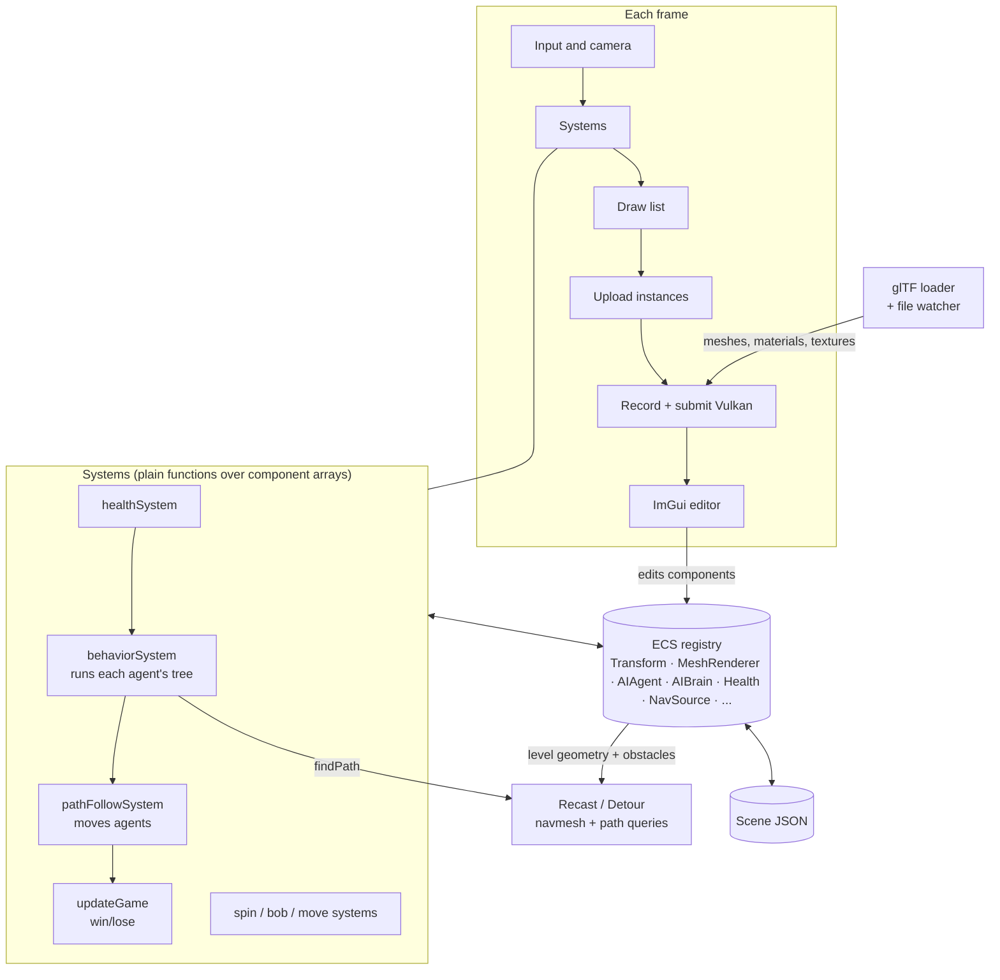
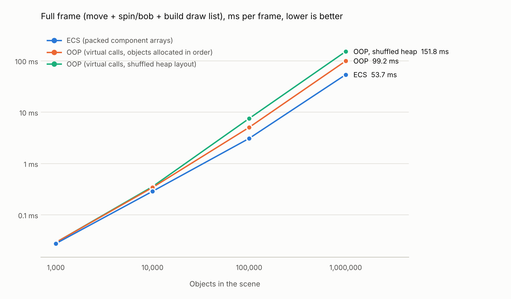
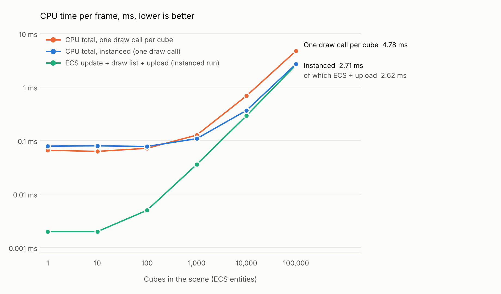

# Toy Engine

A small game engine written from scratch in C++17: a Vulkan renderer, a hand-rolled data-oriented ECS, an ImGui editor, a glTF asset pipeline with hot reload, and navmesh-based AI with behavior trees. It was built layer by layer, and the layers are wired together. The demo level at the end uses all of them at once.

<!-- Add after recording: [](YOUR_VIDEO_LINK) -->

**Headline numbers** (details and caveats in [`docs/benchmarks.md`](docs/benchmarks.md)):

- The sparse-set ECS runs a full simulate-and-build-draw-list frame **1.85x faster than a conventional virtual-call OOP scene at 1M objects** (2.8x if the OOP heap is fragmented), and is about even at small sizes.
- GPU instancing cuts the CPU cost of submitting 100,000 draws from 1.97 ms to 0.09 ms (21x). After that, the ECS pass is 97% of the CPU frame, so the bottleneck moves to my own code.
- The software rasterizer I wrote first is 25x to 234x slower than the Vulkan renderer on the same scene.

## What is in it

| Layer | What it does |
|---|---|
| **Software rasterizer** (`main.cpp`) | CPU pipeline: transform chain, perspective-correct interpolation, depth buffer, texturing. Built first so the GPU pipeline is not a black box. |
| **Vulkan renderer** (`vk_main.cpp`) | Instanced drawing from an ECS draw list, 3 point lights, mip-mapped sRGB textures with anisotropic filtering, per-material descriptor sets, wireframe/fill pipelines, pipeline rebuild on shader change, GPU timestamp profiling. |
| **ECS** (`ecs.h`, `components.h`, `ecs_systems.h`) | Sparse-set component pools, multi-component `each<>()` queries, systems as plain functions. Benchmarked against an OOP scene graph. |
| **Editor** (ImGui + ImGuizmo) | Ray picking, move/rotate/scale gizmos, hierarchy, inspector, add/remove components, duplicate/delete, JSON scene save/load (Ctrl+S, auto-load on start). |
| **Asset pipeline** (`gltf_loader.*`) | glTF/GLB via cgltf and stb_image: node transforms, multiple materials and textures, KHR_texture_transform, alpha-mask and double-sided materials. Warns on unsupported features. Hot reload of shaders (recompiles with glslc) and of glTF assets (entities are re-pointed, no restart). |
| **Navigation** (`navmesh.*`) | Recast builds a navmesh from the scene's geometry; entities are marked *level geometry*, *obstacle* or *ignored* in the Inspector. Detour answers path queries. Debug overlay, path preview, `moveAlong` for keyboard movement. |
| **AI** (`bt.h`, `ai_systems.h`) | Path-following agents; a hand-written behavior tree (`Selector`, `Sequence`, `Leaf`) that patrols, chases the player and flees when hurt; per-agent tuning in the Inspector; a live view of which tree node is active. |
| **Demo level** (`demo_level.h`) | A zig-zag course with four guards, a start pad and a goal, with win/lose and restart. It is built from the same entities and components the editor produces. |

## Architecture



How the pieces connect:

- **Everything is data in the ECS.** An AI guard is a `Transform` + `MeshRenderer` + `AIAgent` (how it walks) + `AIBrain` (what it remembers and its tuning) + `Health`. The editor, the scene file, the renderer and the AI all read and write those same components, so there is no separate "AI object" to keep in sync.
- **The renderer only sees a draw list.** `buildDrawList` turns entities with a mesh into a flat array of model matrices, grouped by mesh and uploaded to a per-frame instance buffer. Meshes, textures and materials are looked up by ID.
- **The behavior tree holds no per-agent state.** One tree is shared by all agents; each agent's memory (patrol index, timers, whether it is fleeing, last-tick trace for the debug view) lives in its `AIBrain`. Leaves do not talk to Detour directly, they call an injected `PathFn`, which is why the whole AI loop runs headless in tests with either a fake or a real navmesh.
- **The tree is re-evaluated from the root every tick**, so a higher-priority branch (flee) interrupts a lower one (chase) as soon as its condition becomes true. Leaves are written so that re-running them is cheap: they only ask for a new path when something changed.

The tree itself:

```
Selector "Root"
├─ Sequence "Flee when hurt"    → IsHealthLow, Flee
├─ Sequence "Chase the player"  → IsPlayerInRange, MoveToPlayer
├─ Leaf "Patrol"
└─ Leaf "Idle"
```

More detail (frame order, file map, the navmesh build, design trade-offs): [`docs/ARCHITECTURE.md`](docs/ARCHITECTURE.md).

## Benchmarks

### ECS vs. an object-oriented scene

Same simulated scene (move, spin and bob, build a model matrix per object), CPU only, run through the sparse-set ECS and a conventional heap-allocated `GameObject` hierarchy with virtual calls. "Shuffled" scrambles the OOP allocation order, like a scene that has been edited for a while.



| Full frame, ms | 1k objects | 10k | 100k | 1M |
|---|---:|---:|---:|---:|
| ECS | 0.028 | 0.287 | 3.07 | 53.7 |
| OOP | 0.029 | 0.340 | 5.04 | 99.2 |
| OOP, shuffled heap | 0.029 | 0.354 | 7.51 | 151.8 |
| **ECS advantage** | 1.05x | 1.19x | 1.64x | 1.85x (2.83x vs. shuffled) |

The gap is widest on the cheapest per-object work (the move system is 5.8x faster at 1M objects) and disappears at small sizes, which is what a cache-locality effect should look like. The OOP baseline is deliberately plain; a leaner OOP design would narrow the gap. Single runs on one machine, MSVC `/O2`; on GCC the draw-list step was roughly even up to 100k objects. See [`docs/benchmarks.md`](docs/benchmarks.md) for method, per-workload tables and caveats.

### Instancing, and where the bottleneck moves



At 100,000 cubes, recording and submitting commands falls from 1.97 ms to 0.09 ms with instancing, but the total CPU frame only improves 1.8x (4.78 ms to 2.71 ms) because the ECS update, draw-list build and upload now take 2.62 ms of it. Below about 1,000 cubes instancing makes no difference.

### Software rasterizer vs. Vulkan

Same scene at 800x600: the CPU rasterizer needs 16.6 ms for one cube and 29.5 ms for 10,000; Vulkan needs 0.013 to 0.128 ms of GPU time (0.075 to 1.16 ms of CPU submission). The two renderers do not shade identically, so treat the ratios as order-of-magnitude. 

## Building

Developed and tested on Windows with an NVIDIA GPU (RTX 5060 Laptop), using MSVC, CMake and Ninja. The headless tests also build with GCC and Clang on Linux; the Vulkan app has not been built anywhere else.

**You need:** a C++17 compiler, CMake 3.20+, Ninja (or Visual Studio), and the [Vulkan SDK](https://vulkan.lunarg.com/) (for the headers, validation layers and `glslc`).

```powershell
git clone --recurse-submodules https://github.com/MBA009/toy-engine.git
cd toy-engine
cmake -G Ninja -S . -B build -DCMAKE_BUILD_TYPE=Release
cmake --build build
.\build\ToyEngineVk.exe        # the editor / demo
```

Third-party code:

| Library | How it is included |
|---|---|
| GLFW, Dear ImGui (v1.91.9), ImGuizmo, cgltf, Recast & Detour (v1.6.0) | git submodules in `external/` (`--recurse-submodules` is required) |
| `stb_image.h` | single header, `external/stb/` |
| nlohmann/json 3.11.3 | single header, `external/json/nlohmann/json.hpp` |

Other executables: `ToyEngine` (the software rasterizer) and `EcsBench` (the ECS vs. OOP benchmark). `ToyEngineVk.exe --bench` runs the benchmark mode (no editor UI) used for the Vulkan numbers.

Models for the asset pipeline are not in the repo. Any `.glb`/`.gltf` works; the [Khronos sample models](https://github.com/KhronosGroup/glTF-Sample-Models) (Box, BoxTextured, Duck) are the ones the tests use. Put them in `tests/` and drag or load them from the Assets panel.

## Using the editor

| Input | Action |
|---|---|
| Hold **right mouse** + **W A S D**, **Q E**, **Shift** | Fly the camera |
| Left click | Select (when no tool is armed) |
| **W / E / R** (not while flying) | Gizmo: move / rotate / scale |
| **Delete**, **Esc**, **Ctrl+S** | Delete selected, deselect / cancel a tool, save scene |
| **Arrow keys** | Walk the player (camera-relative, stays on the navmesh) |

### Try the demo

1. Open the **Navmesh** section of the main panel and click **Build demo level**. It builds the course, bakes the navmesh and arms click-to-move.
2. Walk the player (blue START ring) to the glowing GOAL with the arrow keys or by clicking the floor. Four guards patrol; get close and they chase. Their labels show the active behavior-tree node, and **AI Debug** shows the whole tree coloured by what each node returned.
3. Touch a guard and both of you lose health. A guard under 30% runs for the farthest patrol point until it has recovered to 70%. Lose all your health and the run ends; **Play again** resets it.
4. To build your own: bake a navmesh, use **Place...** to drop guards or the player on it (any imported model works), edit their detection range, flee threshold and patrol points in the Inspector, and save with Ctrl+S.

## Tests

Headless tests (no GPU or window) cover the ECS, the behavior tree and AI systems, scene serialization, navmesh building and queries, picking math, the glTF loader, the file watcher and the demo level (the course is completable, every patrol route is walkable, win and lose both trigger). They also ran clean under AddressSanitizer and UBSan during development.

```powershell
cmake --build build
ctest --test-dir build -C Release --output-on-failure
```

(`cmake/Tests.cmake` registers them; `gltf_test` needs the three Khronos sample models in `tests/`.)

## Repository layout

```
src/        engine, editor and tests (header-only ECS/AI; vk_main.cpp is the Vulkan app)
shaders/    GLSL (mesh.vert, mesh.frag), recompiled on change by the running editor
external/   third-party libraries (submodules and single headers)
tests/      hand-made glTF test files (+ downloaded sample models)
cmake/      test registration
docs/       benchmark reports, charts, architecture notes, demo script
scripts/    clean-checkout build check
```

## Known limitations

- Windows + NVIDIA is the only configuration I have run the Vulkan app on.
- The demo level uses the built-in cube only (uniform scale, one colour), so walls are rows of cubes.
- Navmesh baking is manual (a button), not automatic when obstacles move; saved scenes do not store baked navmeshes or agents' current paths.
- Agents do not avoid each other, and agents only flee toward their own patrol points.
- glTF: no skinning or animation, no normal/metallic/emissive maps, alpha-blended materials are drawn with an alpha test, Draco and meshopt compression are rejected.
- The debug overlays (navmesh, paths, AI labels) have no depth test, so they show through walls.
- The ECS has no generation counters on entity IDs and does not allow adding or removing components inside an `each()` callback.

## What I would do next

Cascaded or at least single-light shadow maps; parallelising the ECS systems (the instancing benchmark shows they are now the CPU bottleneck); crowd avoidance with Detour's crowd/obstacle-avoidance module; navmesh rebuild on edit; a behavior tree that can be loaded from a file instead of C++.

## License

MIT, see [`LICENSE`](LICENSE). Third-party libraries keep their own licenses (GLFW: zlib; Dear ImGui, ImGuizmo, cgltf, stb, nlohmann/json: MIT; Recast & Detour: zlib).
